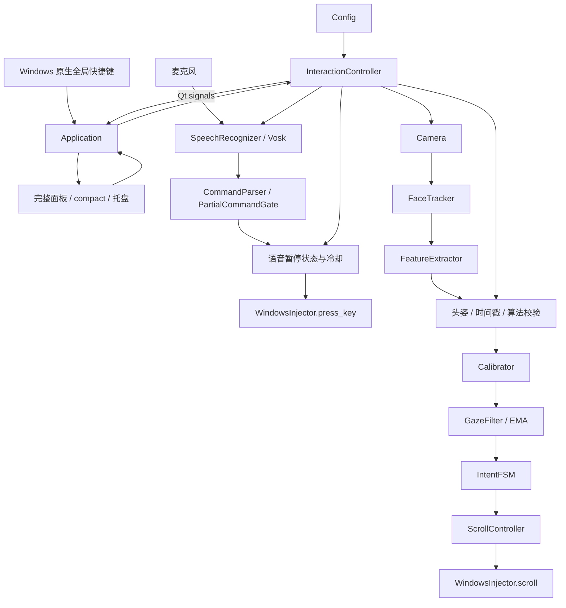
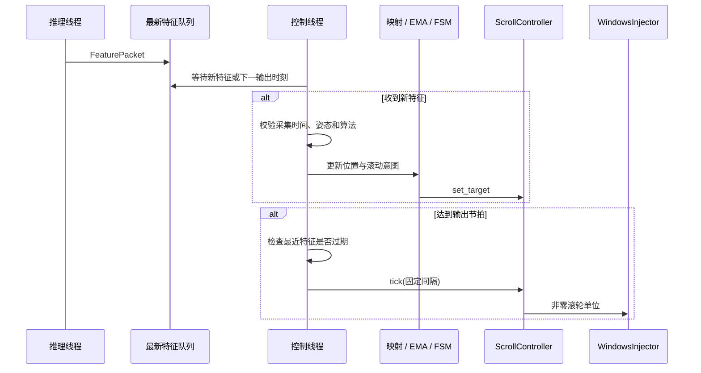
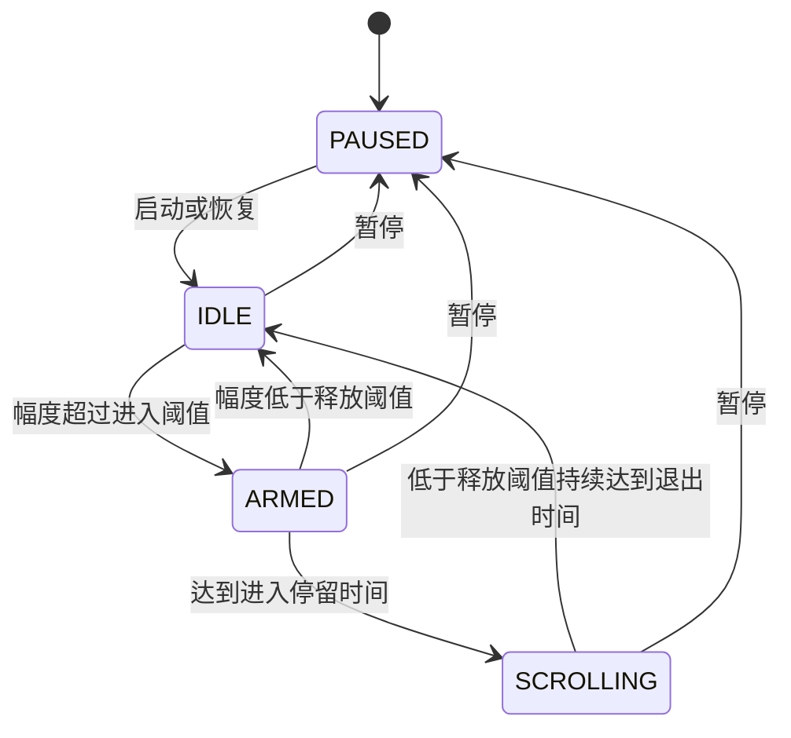

# HeadScroll 系统架构

## 1. 系统边界

HeadScroll 是 Windows 桌面应用，当前运行模式为 `voice` 和 `head`。入口 [src/main.py](src/main.py) 中的 `Application` 负责 Qt 生命周期和界面接线，`InteractionController` 负责识别、控制和输入注入。

语音模式使用麦克风、本地 Vosk 模型和翻页按键。头部模式使用摄像头、MediaPipe、标定映射和滚轮消息。两种模式共享配置、输入注入、完整面板、compact 状态窗、托盘和原生全局快捷键。

## 2. 总体数据流



`GazeFilter` 是现有通用 EMA 类名；当前运行路径传入头部映射位置和有效性，不使用眼动数据。头部模式创建追踪器时关闭虹膜细化，特征提取不执行眼动或 EAR 计算，状态机不接收眨眼输入。

## 3. 模块与实际接口

| 文件或模块 | 职责 | 主要接口 |
| --- | --- | --- |
| `src/main.py` | 模式与线程生命周期、时间有效性、标定同步、界面接线 | `start/stop/pause/resume/reload_settings` |
| `capture/camera.py` | 摄像头采集及单调时间戳 | `start()`、`get_frame()`、`stop()` |
| `tracking/face_tracker.py` | MediaPipe 推理、模型路径、固定后端算法标识 | `process(frame)`、`head_pose_algorithm`、`close()` |
| `tracking/feature_extractor.py` | 头姿计算及有效性 | `extract(landmarks, timestamp)` |
| `tracking/speech_recognizer.py` | 麦克风采样、Vosk 识别、指令与部分结果门控 | `SpeechRecognizer.run(stop_event, callback)` |
| `calibration/calibrator.py` | 参考校验与位置映射 | `load_calibration(top, middle, bottom)`、`map(value)`、`clear()` |
| `processing/filter.py` | EMA 及输入有效性门控 | `update(raw, confidence, present, timestamp)`、`reset()` |
| `control/intent_fsm.py` | 双向滚动触发与暂停 | `update(position, present, lost, timestamp)`、`reset(paused)` |
| `control/scroll_controller.py` | 速度曲线、速度变化限制、滚轮量积分 | `set_target(ratio)`、`tick(dt, smooth_scroll)` |
| `injection/base.py` | 共享输入注入契约 | `init/scroll/press_key/shutdown` |
| `injection/windows.py` | Windows 滚轮消息与键盘事件 | `WindowsInjector` |
| `utils/config.py` | 默认与个人配置、验证、原子写入 | `load/save/apply_settings` |
| `utils/app_logging.py` | 运行日志和错误日志 | `setup_logging/get_logger` |
| `ui/` | 完整面板、compact、托盘、标定、设置与快捷键 | Qt signals 和状态更新方法 |

路径均相对 `src/`，入口文件除外。当前输入注入平台为 Windows，实现位于 `injection/windows.py`。

## 4. 语音路径

`CommandParser` 规范化识别文本并按完整指令匹配，支持上一页、下一页、暂停和恢复四种动作，以及可选唤醒词。限定词表同时交给 Vosk。

`SpeechRecognizer` 使用单声道、16 位音频，默认采样率 16000 Hz、采样块 1600 帧。音频队列上限为 20 项，队列满时丢弃旧项以限制积压。

`PartialCommandGate` 对快速档要求一次匹配、均衡档要求两次连续匹配；准确档等待完整结果。提前触发只用于上一页/下一页，同一语句不重复发送最终翻页。暂停/恢复使用完整结果。

控制器在控制锁内检查停止状态、暂停状态和冷却时间，再调用 `press_key`。一次翻页对应一组键盘按下和释放事件。语音翻页始终面向当前前台窗口。

## 5. 头姿、参考与数据结构

### 5.1 算法标识

| 标识 | 来源与处理 |
| --- | --- |
| `face_matrix_pitch_v1` | MediaPipe 4×4 变换矩阵，有限性/形状检查、SVD 去尺度、有效旋转检查后读取俯仰角 |
| `face_landmark_pitch_v1` | 旧 Face Mesh 后端，鼻尖/下巴差值按图像高和宽统一 Y/Z 尺度 |
| `unavailable` | 当前特征没有可用算法或头姿 |

后端固定选择算法。矩阵算法的矩阵缺失、退化、反射或姿态奇异时返回 NaN，不切换为另一个估算算法。用于头部控制的角度以低头增大为约定。

### 5.2 FeaturePacket

控制路径使用以下字段。

| 字段 | 含义 |
| --- | --- |
| `timestamp` | 摄像头采集时的单调时间戳 |
| `head_pitch` | 头部俯仰角，单位 rad；无效时为 NaN |
| `face_present` | 是否检测到人脸 |
| `head_pose_valid` | 角度是否有限且可用 |
| `head_pose_algorithm` | 实际算法标识 |

现有数据包还保留 `gaze_y_raw`、`blink_state`、`ear` 等历史字段，当前提取器填入固定占位值；`confidence` 由头姿有效性生成。它们不参与眼动或眨眼控制。当前 UI 状态通过 Qt signals 更新，没有独立的 `SharedState` 数据类。

### 5.3 标定参考

配置保留一套 `r_top/r_mid/r_bottom`，并记录 `timestamp`、`pose_source` 和 `reference_algorithm`。控制器只有在时间戳存在、参考算法匹配当前追踪后端且头部参考通过校验时才加载参考。

头部入口要求三点有限、抬头值小于中值、中值小于低头值，且总范围至少为 0.05 rad。通用 `Calibrator` 的映射接口仍支持正向和反向锚点，头部动作顺序校验位于专用入口 `head_reference_error`。

三点标定由 `CalibrationWizard` 收集有效样本；两端点记录由 `HeadCenterCalibrationDialog` 采集两端并计算中值。两者最终调用 `save_head_calibration` 更新同一参考，变化后重置运动状态。

## 6. 线程与同步

### 6.1 线程职责

| 模式 | 工作线程 | 职责 |
| --- | --- | --- |
| voice | 语音线程 | 音频读取、识别、指令回调 |
| head | 采集线程 | 摄像头读取，帧队列只保留最新 1 项 |
| head | 推理线程 | MediaPipe 推理、特征提取，特征队列只保留最新 1 项 |
| head | 控制线程 | 新特征处理、节拍调度、滚轮输出 |
| 两种模式 | Qt 主线程 | 界面、托盘、原生快捷键事件、设置及标定流程 |

### 6.2 生命周期

`_lifecycle_lock` 串行化启动、停止和设置重载。`_control_lock` 保护运动状态、语音指令和输入注入。停止事件通知工作线程退出；停止时先清除状态、关闭输入注入，再等待线程结束。

采集线程退出时释放摄像头。识别线程仍在使用追踪器时不会关闭追踪器。任一旧工作线程仍存活时，新一轮启动被拒绝；设置重载同样检查退出状态。

暂停、恢复、标定参考变化、无效姿态和特征过期会清除滤波、速度、滚轮累积量和触发计时。恢复时以当前时间建立新帧门槛。

### 6.3 特征与输出节拍



只有时间戳更新、未过期且不在未来的特征才更新位置和停留计时。控制线程按 `scroll.tick_hz` 独立输出，错过节拍后从当前时间安排下一次，不积分补发积压事件。

## 7. 状态机与速度



无效姿态和过期特征重置为 IDLE；用户已暂停时保持 PAUSED。参考不可用时输出状态为 `NEEDS_CALIBRATION`，无效姿态为 `INVALID_POSE`，特征中断时为 `FACE_LOST`。停止后界面显示 `STOPPED`。

```text
m = clamp(abs(s_f - 0.5) * 2, 0, 1)
ratio = sign(s_f - 0.5) * clamp((m - th_on) / (1 - th_on), 0, 1)
v_target = sign(ratio) * abs(ratio)^gamma * v_max
```

目标比例只在 SCROLLING 且幅度超过进入阈值时非零。滚动控制器限制速度增减，并按 `v_current * dt * 120` 积分。平滑模式以 1 单位取整，整格模式以 120 单位取整，未输出余量保留到后续节拍。

## 8. Windows 输入契约

`scroll(delta)` 接收 Windows 滚轮单位，120 单位为一格，正值表示向下。注入器按 Windows 消息方向转换符号，不再乘以 120。`press_key(key)` 支持 Left、Right、PageUp、PageDown，发送按下和释放两项 `INPUT`。

滚轮目标为 `cursor`、`foreground` 或 `process`。指定进程按可执行文件名匹配可见顶层窗口，路径经 `ntpath.basename` 规范化。

窗口消息使用 `SendMessageTimeoutW`，带 `SMTO_ABORTIFHUNG | SMTO_ERRORONEXIT`，超时参数为 100 ms。指定进程缺失和目标消息失败返回错误，控制器随后停止。鼠标/前台模式仅在无法定位窗口时可退回系统滚轮事件；已定位目标发送失败时不转发到别处。

## 9. 配置与日志

默认配置以 [config/default_config.json](config/default_config.json) 为准。

| 配置组 | 主要用途或当前默认值 |
| --- | --- |
| `mode` | 默认 `voice`，可切换 `head` |
| `camera` | 设备 0，640×480，目标 30 FPS |
| `voice` | 16000 Hz、550 ms 冷却、balanced 响应档位、指令与翻页按键 |
| `calibration` | 三点参考、时间戳、来源与算法；初始无有效标定 |
| `filter` | EMA 0.75，特征有效期 500 ms |
| `thresholds` | 进入/释放 0.45/0.35，停留 120/80 ms |
| `scroll` | 最大速度 3 格/秒，gamma 1.8，速度增减参数 8/16，输出 90 Hz |
| `injection` | 默认亚刻度滚动，目标 `cursor` |
| `ui` | 默认置顶，Ctrl+Shift+Space 暂停/恢复，Escape 停止 |

`blink` 配置仍可被读取和保存，当前控制路径不消费其参数。`confidence_min` 是通用滤波器字段，头部路径先进行有效性校验再传入有效值。

源码运行从项目 `config/` 加载配置。打包运行从资源目录读取默认配置，个人配置与日志位于 `%LOCALAPPDATA%\HeadScroll`。个人配置通过同目录临时文件、flush/fsync 和 `os.replace` 原子保存。`apply_settings` 在保存失败时还原此前内存配置。

日志保留事件、运行状态和错误上下文。摄像头帧与音频采样在实时处理队列中传递，不写入媒体文件。

## 10. UI 接线

- `MainWindow` 接线完整面板、compact、托盘及 Qt signals。
- `FloatingPanel` 最小化或关闭后请求显示 `CompactStatusWindow`，可恢复完整面板。
- `GlobalHotkeys` 使用 Windows `RegisterHotKey` 和 Qt 原生事件过滤器；配置冲突显示注册错误。
- `CalibrationWizard` 以采集时间戳筛选当前采样阶段，拥有采样、步骤切换、完成提示三组可取消计时器。
- `HeadCenterCalibrationDialog` 记录有效期内两端点；`SettingsDialog` 暂存记录并在保存后应用。
- `ProcessPickerDialog` 通过 Windows `tasklist` 读取进程列表，使用隐藏子进程和有界等待，失败时在对话框显示原因。
- 停止后界面清除暂停状态、检测结果和位置，并显示 STOPPED；已停止时忽略后续状态更新。

## 11. 目录与构建

```text
HeadScroll/
├── src/
│   ├── main.py
│   ├── EyeScroll.spec
│   ├── capture/
│   ├── tracking/             # 人脸、头姿和语音
│   ├── calibration/
│   ├── processing/
│   ├── control/
│   ├── injection/            # base.py、windows.py
│   ├── ui/                   # 面板、compact、托盘、设置、标定、热键
│   └── utils/
├── assets/
│   ├── icon.ico
│   └── models/               # 人脸模型及中文 Vosk 模型
├── config/default_config.json
├── tests/
├── requirements.txt
├── requirements-dev.txt
└── README.md
```

PyInstaller 使用 `src/EyeScroll.spec` 构建目录式 `HeadScroll` 应用。资源包含默认配置、人脸模型和 Vosk 模型；个人配置不进入构建。MediaPipe 和 Vosk 的动态库分别收集，并过滤从其他程序 PATH 中误收集的 ICU DLL。完整目录及其 `_internal` 依赖需要一起分发。

模型定位支持 PyInstaller 资源目录。人脸模型的非 ASCII 路径会复制到临时模型目录后交给 MediaPipe。源码运行若缺少人脸模型会尝试下载；Vosk 模型目录无效时报告启动错误。

## 12. 检查与后续评估

核心逻辑检查覆盖头姿、参考、状态机、时间戳、输出节拍、滚轮单位、定向失败和语音键盘契约。修改源码后执行项目要求的 `python -m compileall -q src`。人工硬件、目标程序和窗口操作步骤见 [tests/README.md](tests/README.md)。

误触发率、启停延迟、丢脸率、CPU/内存和推理 FPS 适合在目标机器与阅读程序上记录。性能评估应同时记录目标机器、摄像头、阅读程序与实际测量结果。
