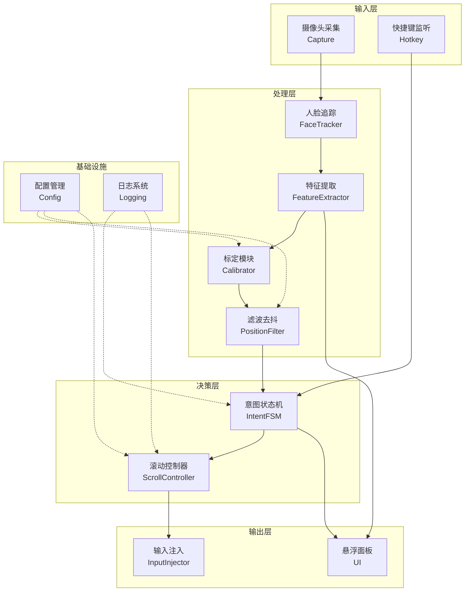
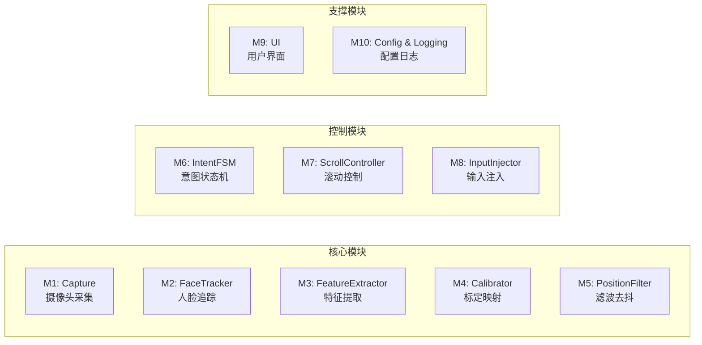
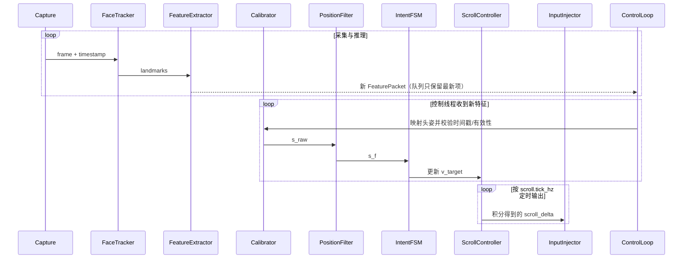
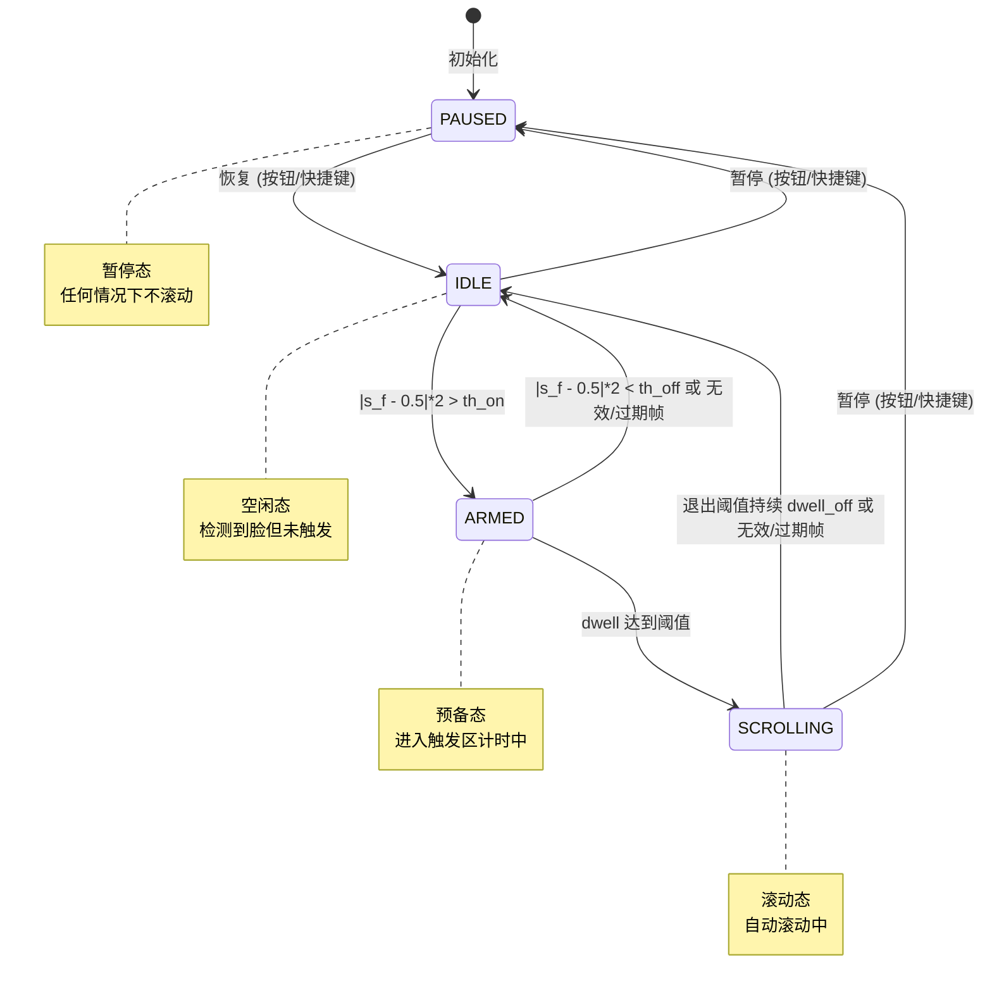
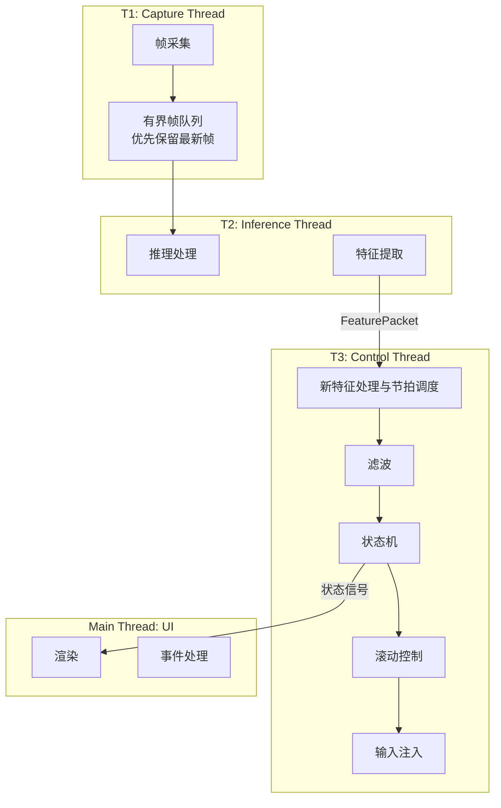
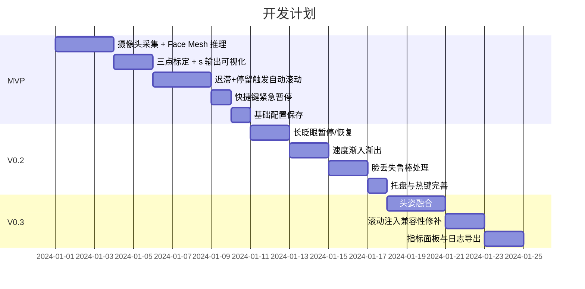

# HeadScroll 头部滚动控制 - 系统架构文档

## 1. 系统概述

### 1.1 项目定位
基于普通摄像头的桌面常驻工具，通过抬头和低头动作实现网页自动平滑滚动，主要用于阅读网页、文档和下拉式漫画。

### 1.2 核心价值
- **解放双手**：无需频繁操作滚轮/按键
- **节奏自然**：阅读进度与滚动速度自适应
- **隐私优先**：全本地处理，不保存视频帧

### 1.3 当前运行行为

- 运行时包含采集、推理、控制和 UI 线程。控制线程同时处理新特征和定时输出；输出间隔由 `scroll.tick_hz` 配置。
- 只有带有更新采集时间戳的新特征帧会更新滤波器、意图状态机和目标速度。重复、过期或乱序特征会被忽略。
- `filter.lost_face_timeout_ms` 是特征有效期上限。过期后控制器清除滤波、意图计时及速度；恢复或标定变化后需要新特征帧重新满足停留条件。
- 错过控制节拍时丢弃错过的输出，不补发滚轮事件。
- `HeadScrollController` 协调上述模块，暂停和恢复由按钮或快捷键控制。

---

## 2. 系统架构

### 2.1 整体架构图



### 2.2 技术栈

| 层级 | 技术选型 | 说明 |
|------|----------|------|
| 语言 | Python 3.10+ | 生态丰富，开发效率高 |
| 图像采集 | OpenCV | 摄像头采集与基础图像处理 |
| 人脸追踪 | MediaPipe Face Landmarker / Face Mesh | 提供头部姿态矩阵或兼容关键点，CPU 可用 |
| GUI | PySide6 | 悬浮窗、托盘菜单、参数面板 |
| 输入注入 | ctypes + SendInput | Windows 优先，跨平台抽象 |

---

## 3. 模块设计

### 3.1 模块划分



### 3.2 模块职责

#### M1: Capture（摄像头采集）
```
职责：摄像头初始化、帧采集、时间戳管理
输入：摄像头设备索引、分辨率配置
输出：带时间戳的视频帧
接口：
  - start() -> bool
  - get_frame() -> (frame, timestamp)
  - stop()
```

#### M2: FaceTracker（人脸追踪）
```
职责：运行 MediaPipe 推理，输出人脸关键点和可用的头部姿态矩阵
输入：视频帧
输出：人脸关键点、头部姿态矩阵及算法标记
接口：
  - process(frame) -> FaceLandmarks | None
```

#### M3: FeatureExtractor（特征提取）
```
职责：从姿态矩阵或兼容关键点计算头部俯仰角
输入：FaceLandmarks
输出：FeaturePacket
接口：
  - extract(landmarks, timestamp) -> FeaturePacket

FeaturePacket 结构：
  - timestamp: float
  - head_pitch: float
  - face_present: bool
  - head_pose_valid: bool
  - head_pose_algorithm: str
```

#### M4: Calibrator（标定映射）
```
职责：采样抬头、自然姿势、低头三点，映射头部俯仰角
输入：头部俯仰角及采集时间戳
输出：归一化值 s ∈ [0,1]
接口：
  - start_calibration()
  - start_position(position: TOP/MID/BOTTOM)
  - add_sample(raw_value, timestamp)
  - finish() -> CalibrationResult
  - map(raw_value) -> s
  - load_calibration(r_top, r_mid, r_bottom)

也可在设置中记录抬头和低头端点，由两端的中点推导中心和相对范围。两条校准路径更新同一组参数，并记录实际头姿算法标记。
```

#### M5: PositionFilter（滤波去抖）
```
职责：EMA 滤波、有效性门控、去抖处理
输入：s_raw, confidence, face_present, timestamp
输出：滤波后 s_f
接口：
  - update(s_raw, confidence, face_present, timestamp) -> s_f
  - reset()

入口只接受有效且与标定算法匹配的头姿。传给滤波器的 confidence 为 0/1 有效性，不使用眼部置信度。
```

#### M6: IntentFSM（意图状态机）
```
职责：判定用户滚动意图，状态转换
输入：s_f, face_present, face_lost, timestamp
输出：目标速度 v_target, 当前状态
接口：
  - update(s_f, face_present, face_lost, timestamp) -> (state, v_target)
  - pause() / resume()
  - reset(paused=True)
```

#### M7: ScrollController（滚动控制器）
```
职责：速度平滑、滚轮事件生成
输入：v_target
输出：滚轮步进事件
接口：
  - set_target(v_target)
  - tick(dt, smooth_scroll) -> scroll_delta

控制器应用速度曲线和加减速限制，并累积不足一个输出步长的滚轮量。
```

#### M8: InputInjector（输入注入）
```
职责：通过 Windows 输入接口向目标窗口发送滚轮事件
输入：scroll_delta
输出：系统滚轮事件
接口：
  - init() -> bool
  - scroll(delta: int) -> bool
  - shutdown()
```

#### M9: UI（用户界面）
```
职责：悬浮面板、托盘、热键、状态显示
组件：
  - FloatingPanel: 主控面板
  - TrayIcon: 系统托盘
  - CalibrationWizard: 标定向导
  - SettingsDialog: 参数设置
```

#### M10: Config & Logging
```
职责：配置加载保存、结构化日志
文件：config.json
日志：事件时间戳、数值指标（不含图像）
旧配置中的眼动、融合和眨眼设置被忽略；旧眼动参考停用，已有算法标记且有效的头部参考保留。
```

模块接口以上述当前运行路径为准；后文的目录树、跨平台实现及性能数字是早期设计草案，分别在对应章节标出。

---

## 4. 数据流设计

### 4.1 主数据流



上述三段工作在同一个控制线程中串行协调。新特征驱动滤波、FSM 和目标速度更新；定时节拍只推进速度并输出滚轮事件，不会重复处理旧特征。过期、重复或乱序特征被忽略；特征过期后清除运动状态，需新帧重新满足停留时间。错过的节拍直接丢弃，不补发。

### 4.2 核心数据结构

```python
@dataclass
class FeaturePacket:
    """特征数据包"""
    timestamp: float          # 帧时间戳
    head_pitch: float        # 头部俯仰角
    face_present: bool       # 是否检测到人脸
    head_pose_valid: bool    # 头姿是否有效
    head_pose_algorithm: str # 头姿估计算法标识
```

注：这里列出的是当前 `FeaturePacket` 字段。UI 状态通过 Qt signal 更新；当前实现没有此处旧草案中的 `SharedState` 数据类。

---

## 5. 状态机设计

### 5.1 状态定义



### 5.2 状态说明

| 状态 | 描述 | 滚动行为 |
|------|------|----------|
| `PAUSED` | 暂停态 | ❌ 不滚动 |
| `IDLE` | 空闲态 | ❌ 不滚动 |
| `ARMED` | 预备态 | ❌ 不滚动（计时中） |
| `SCROLLING` | 滚动态 | ✅ 自动滚动 |

### 5.3 转换条件

| 转换 | 条件 |
|------|------|
| `IDLE → ARMED` | `|s_f - 0.5| * 2 > th_on`；上下方向共用同一触发区 |
| `ARMED → SCROLLING` | 停留时间 ≥ `dwell_on` |
| `ARMED → IDLE` | `|s_f - 0.5| * 2 < th_off` 或收到无效帧/特征过期 |
| `SCROLLING → IDLE` | 低于退出阈值达到 `dwell_off`，或收到无效帧/特征过期 |
| `任意 → PAUSED` | 按钮或快捷键 |
| `PAUSED → IDLE` | 按钮或快捷键；随后需要新帧重新累计进入停留时间 |

暂停、标定变化和特征过期都会清除滤波和滚动计时。过期时限来自 `filter.lost_face_timeout_ms`。

---

## 6. 线程模型

### 6.1 线程架构



### 6.2 线程职责

| 线程 | 频率 | 职责 |
|------|------|------|
| T1 Capture | 相机帧率 | 采集帧，写入有界队列并丢弃旧帧 |
| T2 Inference | 由采集和推理决定 | 推理、特征提取，向控制线程交付最新特征 |
| T3 Control | 事件驱动 + `scroll.tick_hz` | 新特征时更新滤波、状态机和目标速度；按配置节拍推进速度并注入滚轮 |
| Main UI | 事件驱动 | 渲染、用户交互 |

### 6.3 同步机制
- **帧/特征队列**：有界队列，生产侧移除旧项以降低延迟
- **控制状态**：由控制线程维护；UI 通过 Qt signal 收到状态更新
- **节拍**：基于单调时钟调度；错过的节拍丢弃，不进行延迟补发

---

## 7. 关键算法

### 7.1 头部位置映射

```
输入: 头部俯仰角及有效标定参考
输出: 头部位置 s_raw ∈ [0,1]

算法:
1. 从中心与相对范围得到抬头、中心、低头参考
2. 将抬头到中心映射至 [0,0.5]，中心到低头映射至 [0.5,1]
3. 裁剪到 [0,1]；无有效参考时停止滚动并提示重新标定
```

### 7.2 滤波与去抖

```
EMA 滤波:
  s_f = α * s_f_prev + (1-α) * s
  
有效性门控:
  人脸存在，头姿有效且算法标识与标定匹配

无效输入:
  立即清除滤波、滚动速度和意图计时，恢复后从新特征帧重新判断

迟滞阈值（上下方向对称）:
  m = clamp(abs(s_f - 0.5) * 2, 0, 1)
  进入预备态: m > th_on
  开始滚动: 持续 dwell_on
  退出触发区: m < th_off；在滚动态持续 dwell_off 后回到 IDLE

特征时间:
  按采集 timestamp 去重；丢弃重复、乱序及超过 lost_face_timeout_ms 的特征
  最近特征超过 lost_face_timeout_ms 后清除运动状态
  
其中 th_on > th_off，避免边界抖动
```

### 7.3 速度映射

```
状态机目标比例:
  ratio = sign(s_f - 0.5) * clamp((m - th_on)/(1 - th_on), 0, 1)

滚动控制器目标速度:
  v_target = sign(ratio) * abs(ratio)^γ * v_max
  
速度渐变:
  v = v_prev + clamp(v_target - v_prev, -a_down*dt, a_up*dt)

滚轮输出:
  仅在 SCROLLING 状态按 tick_hz 积分速度；smooth_scroll 时按 1 个滚轮单位取整，否则按 120 个单位取整
```

Windows 滚轮消息仍受目标应用的处理方式影响，1 个单位的亚刻度事件可能被合并或取整。

### 7.4 头部俯仰角

- 优先从 MediaPipe 面部变换矩阵分离旋转并提取 X 轴俯仰角。
- 仅当检测结果标记为旧版算法时，才使用鼻尖与下巴两点估算；Y/Z 坐标按图像高/宽换算到一致单位。
- 无效矩阵或姿态奇异时停止滚动，等待有效头姿；算法与已保存标定不匹配时需重新标定。
- 头部三点标定记录上、中、下俯仰参考；设置中的快速范围校准记录抬头和低头两端，以两端中点更新中心。

---

## 8. 接口设计

### 8.1 输入注入抽象接口

```python
class InputInjector(ABC):
    """输入注入抽象基类"""
    
    @abstractmethod
    def init(self) -> bool:
        """初始化注入器"""
        pass
    
    @abstractmethod
    def scroll(self, delta: int) -> bool:
        """发送滚轮事件，delta 正值向下滚"""
        pass
    
    @abstractmethod
    def shutdown(self) -> None:
        """关闭注入器"""
        pass
```

### 8.2 平台实现

| 平台 | 实现方式 | 状态 |
|------|----------|------|
| Windows | `ctypes`；向目标窗口发送 `WM_MOUSEWHEEL`，必要时使用 `SendInput` | 当前实现 |
| macOS | Quartz CGEvent | 早期候选方案，尚未实现 |
| Linux | uinput/evdev | 早期候选方案，尚未实现 |

`cursor` 和 `foreground` 模式在无法定位窗口时可退回系统滚轮事件。`process` 模式按可见顶层窗口对应的可执行文件名匹配目标进程；找不到窗口或发送失败时返回错误，不退回其他目标。注入错误会停止控制器。

---

## 9. 配置体系

### 9.1 配置文件结构

下面的 JSON 和推荐值来自早期配置草案，不代表随包默认值。实际字段和默认值以 `config/default_config.json` 为准。

```json
{
  "camera": {
    "index": 0,
    "width": 640,
    "height": 480,
    "target_fps": 30
  },
  "calibration": {
    "r_top": 0.25,
    "r_mid": 0.50,
    "r_bottom": 0.75,
    "method": "linear",
    "timestamp": "2024-01-01T00:00:00"
  },
  "fusion": {
    "w_gaze": 0.8,
    "w_pitch": 0.2
  },
  "filter": {
    "ema_alpha": 0.85,
    "confidence_min": 0.6,
    "lost_face_timeout_ms": 500
  },
  "thresholds": {
    "th_on": 0.78,
    "th_off": 0.70,
    "dwell_on_ms": 400,
    "dwell_off_ms": 100
  },
  "scroll": {
    "v_max": 5.0,
    "gamma": 1.5,
    "a_up": 10.0,
    "a_down": 20.0,
    "tick_hz": 60
  },
  "ui": {
    "always_on_top": true,
    "show_overlay": false,
    "hotkeys": {
      "toggle_pause": "Ctrl+Shift+Space",
      "emergency_stop": "Escape"
    }
  }
}
```

### 9.2 早期调参示例

| 参数 | 示例值 | 建议范围 | 说明 |
|------|--------|------|------|
| `th_on` | 0.78 | 0.75-0.85 | 进入触发阈值 |
| `th_off` | 0.70 | 0.65-0.75 | 退出触发阈值 |
| `dwell_on_ms` | 400 | 300-600 | 停留触发时间 |
| `ema_alpha` | 0.85 | 0.7-0.92 | 滤波系数 |

---

## 10. 目录结构（早期规划）

下面的目录树仅作历史设计参考，当前仓库布局以 README 的目录树和实际文件为准；其中 macOS/Linux 注入器、独立托盘/悬浮面板及列出的测试文件不表示当前已实现。

```
manga-scroll-eye-control/
├── src/
│   ├── __init__.py
│   ├── main.py                 # 程序入口
│   ├── capture/
│   │   ├── __init__.py
│   │   └── camera.py           # M1: 摄像头采集
│   ├── tracking/
│   │   ├── __init__.py
│   │   ├── face_tracker.py     # M2: 人脸追踪
│   │   └── feature_extractor.py # M3: 特征提取
│   ├── calibration/
│   │   ├── __init__.py
│   │   └── calibrator.py       # M4: 标定模块
│   ├── processing/
│   │   ├── __init__.py
│   │   └── filter.py           # M5: 滤波去抖
│   ├── control/
│   │   ├── __init__.py
│   │   ├── intent_fsm.py       # M6: 意图状态机
│   │   └── scroll_controller.py # M7: 滚动控制器
│   ├── injection/
│   │   ├── __init__.py
│   │   ├── base.py             # 抽象接口
│   │   ├── windows.py          # Windows 实现
│   │   ├── macos.py            # macOS 实现
│   │   └── linux.py            # Linux 实现
│   ├── ui/
│   │   ├── __init__.py
│   │   ├── main_window.py      # 主窗口
│   │   ├── floating_panel.py   # 悬浮面板
│   │   ├── tray_icon.py        # 托盘图标
│   │   ├── calibration_wizard.py # 标定向导
│   │   └── settings_dialog.py  # 设置对话框
│   └── utils/
│       ├── __init__.py
│       ├── config.py           # M10: 配置管理
│       └── logging.py          # M10: 日志系统
├── tests/
│   ├── test_fsm.py             # 状态机单元测试
│   ├── test_filter.py          # 滤波器单元测试
│   └── test_calibrator.py      # 标定模块测试
├── config/
│   └── default_config.json     # 默认配置
├── requirements.txt
├── setup.py
└── README.md
```

---

## 11. 异常处理

### 11.1 异常策略

| 异常类型 | 处理方式 |
|----------|----------|
| 摄像头打开失败 | 提示错误，禁用滚动 |
| 无效头部姿态或缺少匹配标定 | 立即清除滤波、滚动速度和意图计时；有效参考与头姿恢复后需新帧重新累计停留时间 |
| 特征中断或过期 | 超过 `lost_face_timeout_ms` 后清除运动状态；恢复后需新帧重新满足停留时间 |
| 指定进程不存在或输入注入失败 | 停止控制器并报告错误；指定进程模式不向其他窗口回退 |

### 11.2 安全原则

> [!IMPORTANT]
> **所有异常默认"停止滚动"，紧急停止始终可靠**

---

## 12. 开发里程碑

以下时间表是 2024 年的早期计划，仅保留作项目历史记录，不表示当前待办或当前版本状态。



---

## 13. 关键性能指标

以下数值是早期目标值，并非当前版本的实测结果。

| 指标 | 目标值 | 说明 |
|------|--------|------|
| 推理帧率 | 15-30 FPS | 普通笔记本 CPU |
| 启动延迟 | 300-600 ms | 从触发到滚动开始 |
| 停止延迟 | < 200 ms | 从离开触发区到停止 |
| False Start | < 2/min | 误触发频率 |
| CPU 占用 | < 20% | 单核占用 |

---

## 14. 扩展预留

### 14.1 多显示器支持
- 预留显示器索引配置
- 标定数据按显示器存储

### 14.2 滚动目标扩展
- 早期草案：当前前台窗口
- 后续方向：指定应用、窗口句柄

### 14.3 手势扩展
- 预留手势识别接口位
- 支持自定义触发动作
