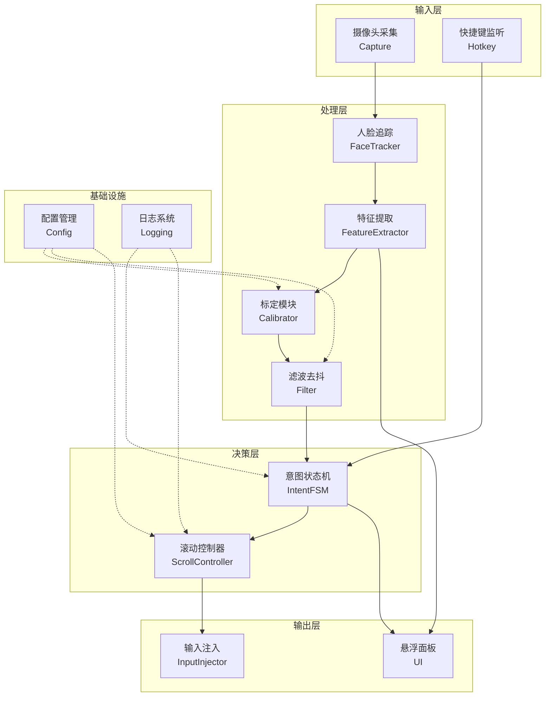
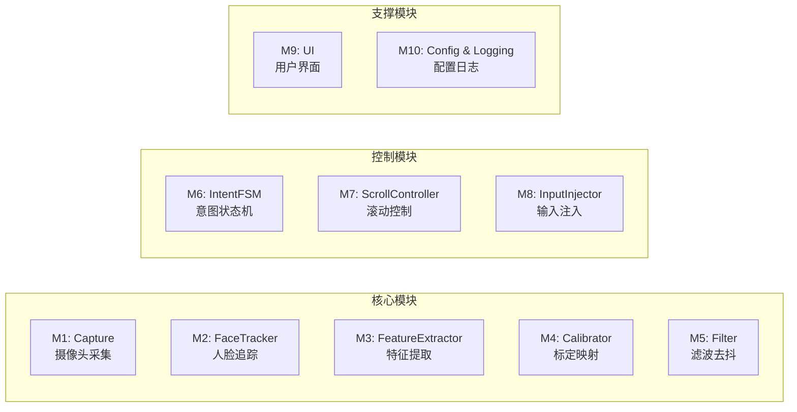
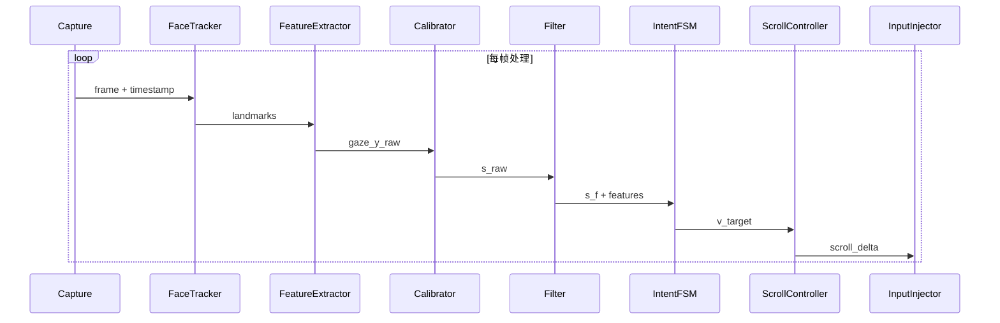
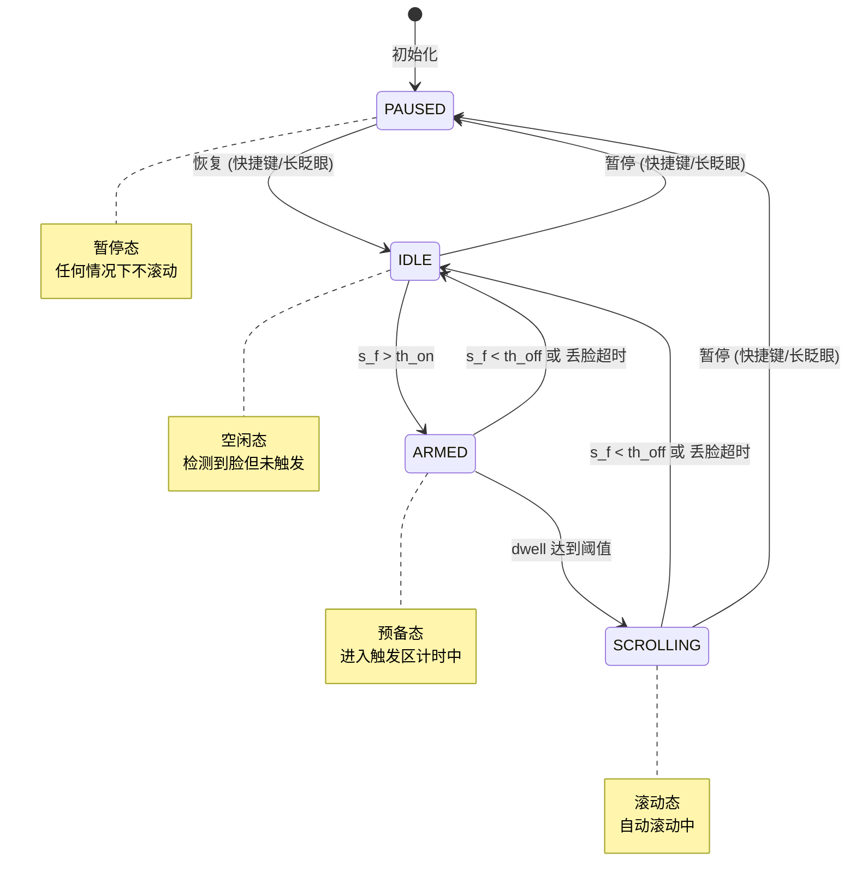
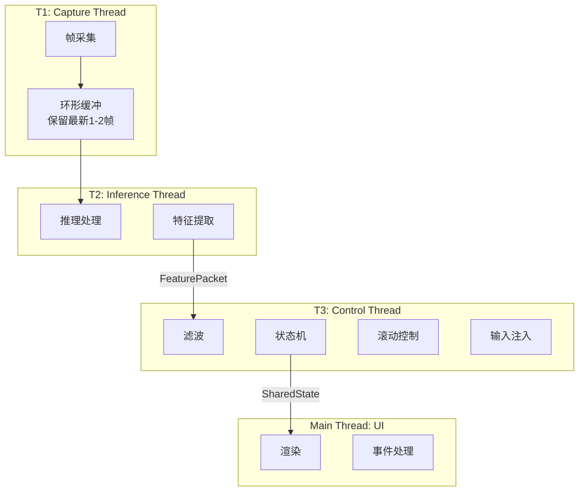
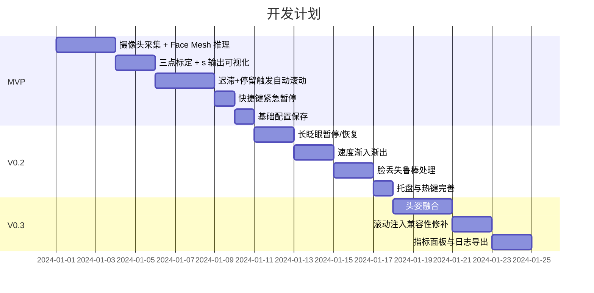

# 眼动控制网页漫画滚动 - 系统架构文档

## 1. 系统概述

### 1.1 项目定位
基于普通摄像头的桌面常驻工具，通过眼神/头姿感知实现网页自动平滑滚动，主要用于阅读下拉式漫画场景。

### 1.2 核心价值
- **解放双手**：无需频繁操作滚轮/按键
- **节奏自然**：阅读进度与滚动速度自适应
- **隐私优先**：全本地处理，不保存视频帧

---

## 2. 系统架构

### 2.1 整体架构图



### 2.2 技术栈

| 层级 | 技术选型 | 说明 |
|------|----------|------|
| 语言 | Python 3.10+ | 生态丰富，开发效率高 |
| 图像采集 | OpenCV | 摄像头采集与基础图像处理 |
| 人脸追踪 | MediaPipe Face Mesh | 含虹膜/眼部关键点，CPU 可用 |
| GUI | PySide6 | 悬浮窗、托盘菜单、参数面板 |
| 输入注入 | ctypes + SendInput | Windows 优先，跨平台抽象 |

---

## 3. 模块设计

### 3.1 模块划分



### 3.2 模块职责

#### M1: Capture（摄像头采集）
```
职责：摄像头初始化、帧采集、时间戳管理
输入：摄像头设备索引、分辨率配置
输出：带时间戳的视频帧
接口：
  - start() -> bool
  - get_frame() -> (frame, timestamp)
  - stop()
```

#### M2: FaceTracker（人脸追踪）
```
职责：运行 MediaPipe Face Mesh 推理，输出关键点
输入：视频帧
输出：468 个人脸关键点 + 虹膜关键点
接口：
  - process(frame) -> FaceLandmarks | None
```

#### M3: FeatureExtractor（特征提取）
```
职责：从关键点计算 gaze_y、眨眼状态、头姿等特征
输入：FaceLandmarks
输出：FeaturePacket
接口：
  - extract(landmarks) -> FeaturePacket

FeaturePacket 结构：
  - timestamp: float
  - gaze_y_raw: float [0,1]
  - confidence: float [0,1]
  - blink_state: enum (OPEN/CLOSING/CLOSED)
  - head_pitch: float
  - face_present: bool
```

#### M4: Calibrator（标定映射）
```
职责：三点标定采样、映射拟合、参数持久化
输入：用户标定采样
输出：映射函数 s = f(gaze_y_raw)
接口：
  - start_calibration()
  - sample(position: TOP/MID/BOTTOM)
  - finish() -> CalibrationResult
  - map(gaze_y_raw) -> s
```

#### M5: Filter（滤波去抖）
```
职责：EMA 滤波、置信度门控、去抖处理
输入：原始 s_raw, confidence
输出：滤波后 s_f
接口：
  - update(s_raw, confidence, dt) -> s_f
  - reset()
```

#### M6: IntentFSM（意图状态机）
```
职责：判定用户滚动意图，状态转换
输入：s_f, blink_state, face_present
输出：目标速度 v_target, 当前状态
接口：
  - update(s_f, features, dt) -> (state, v_target)
  - pause() / resume()
```

#### M7: ScrollController（滚动控制器）
```
职责：速度平滑、滚轮事件生成
输入：v_target
输出：滚轮步进事件
接口：
  - set_target(v_target)
  - tick(dt) -> scroll_delta
```

#### M8: InputInjector（输入注入）
```
职责：跨平台滚轮事件发送
输入：scroll_delta
输出：系统滚轮事件
接口：
  - init() -> bool
  - scroll(delta: int)
  - shutdown()
```

#### M9: UI（用户界面）
```
职责：悬浮面板、托盘、热键、状态显示
组件：
  - FloatingPanel: 主控面板
  - TrayIcon: 系统托盘
  - CalibrationWizard: 标定向导
  - SettingsDialog: 参数设置
```

#### M10: Config & Logging
```
职责：配置加载保存、结构化日志
文件：config.json
日志：事件时间戳、数值指标（不含图像）
```

---

## 4. 数据流设计

### 4.1 主数据流



### 4.2 核心数据结构

```python
@dataclass
class FeaturePacket:
    """特征数据包"""
    timestamp: float          # 帧时间戳
    gaze_y_raw: float        # 原始注视高度 [0,1]
    confidence: float        # 置信度 [0,1]
    blink_state: BlinkState  # 眨眼状态
    head_pitch: float        # 头部俯仰角
    face_present: bool       # 是否检测到人脸

@dataclass  
class SharedState:
    """共享状态"""
    s_f: float               # 滤波后注视高度
    v: float                 # 当前滚动速度
    fsm_state: FSMState      # 状态机状态
    fps: float               # 当前帧率
    last_face_ts: float      # 上次检测到脸的时间
    paused: bool             # 是否暂停
    calibration_ready: bool  # 标定是否完成
```

---

## 5. 状态机设计

### 5.1 状态定义



### 5.2 状态说明

| 状态 | 描述 | 滚动行为 |
|------|------|----------|
| `PAUSED` | 暂停态 | ❌ 不滚动 |
| `IDLE` | 空闲态 | ❌ 不滚动 |
| `ARMED` | 预备态 | ❌ 不滚动（计时中） |
| `SCROLLING` | 滚动态 | ✅ 自动滚动 |

### 5.3 转换条件

| 转换 | 条件 |
|------|------|
| `IDLE → ARMED` | `s_f > th_on` |
| `ARMED → SCROLLING` | 停留时间 ≥ `dwell_on` |
| `ARMED → IDLE` | `s_f < th_off` 或 丢脸超时 |
| `SCROLLING → IDLE` | `s_f < th_off` 或 置信度低超时 |
| `任意 → PAUSED` | 长眨眼或快捷键 |
| `PAUSED → IDLE` | 长眨眼或快捷键 |

---

## 6. 线程模型

### 6.1 线程架构



### 6.2 线程职责

| 线程 | 频率 | 职责 |
|------|------|------|
| T1 Capture | 相机帧率 | 采集帧，写入环形缓冲 |
| T2 Inference | 15-30 FPS | 推理、特征提取 |
| T3 Control | 60 Hz | 滤波、状态机、滚动控制 |
| Main UI | 事件驱动 | 渲染、用户交互 |

### 6.3 同步机制
- **帧缓冲**：环形缓冲，只保留最新 1-2 帧避免延迟堆积
- **特征传递**：线程安全队列或原子变量
- **共享状态**：锁保护或原子读写

---

## 7. 关键算法

### 7.1 注视高度估计

```
输入: Face Mesh 关键点
输出: gaze_y_raw ∈ [0,1]

算法:
1. 提取虹膜中心 y_iris
2. 提取上眼睑参考 y_top  
3. 提取下眼睑参考 y_bottom
4. 单眼归一化: g = (y_iris - y_top) / (y_bottom - y_top)
5. 双眼融合: gaze_y_raw = clamp((g_left + g_right) / 2, 0, 1)
```

### 7.2 滤波与去抖

```
EMA 滤波:
  s_f = α * s_f_prev + (1-α) * s
  
迟滞阈值:
  进入滚动: s_f > th_on 且持续 dwell_on
  停止滚动: s_f < th_off
  
其中 th_on > th_off，避免边界抖动
```

### 7.3 速度映射

```
目标速度:
  v_target = v_max * clamp((s_f - th_on)/(1 - th_on), 0, 1)^γ
  
速度渐变:
  v = v_prev + clamp(v_target - v_prev, -a_down*dt, a_up*dt)
```

---

## 8. 接口设计

### 8.1 输入注入抽象接口

```python
class InputInjector(ABC):
    """跨平台输入注入抽象基类"""
    
    @abstractmethod
    def init(self) -> bool:
        """初始化注入器"""
        pass
    
    @abstractmethod
    def scroll(self, delta: int) -> bool:
        """发送滚轮事件，delta 正值向下滚"""
        pass
    
    @abstractmethod
    def shutdown(self) -> None:
        """关闭注入器"""
        pass
```

### 8.2 平台实现

| 平台 | 实现方式 | 备注 |
|------|----------|------|
| Windows | ctypes + SendInput | MOUSEEVENTF_WHEEL |
| macOS | Quartz CGEvent | 需辅助功能权限 |
| Linux | uinput/evdev | 需 root 或 input 组权限 |

---

## 9. 配置体系

### 9.1 配置文件结构

```json
{
  "camera": {
    "index": 0,
    "width": 640,
    "height": 480,
    "target_fps": 30
  },
  "calibration": {
    "r_top": 0.25,
    "r_mid": 0.50,
    "r_bottom": 0.75,
    "method": "linear",
    "timestamp": "2024-01-01T00:00:00"
  },
  "fusion": {
    "w_gaze": 0.8,
    "w_pitch": 0.2
  },
  "filter": {
    "ema_alpha": 0.85,
    "confidence_min": 0.6,
    "lost_face_timeout_ms": 500
  },
  "thresholds": {
    "th_on": 0.78,
    "th_off": 0.70,
    "dwell_on_ms": 400,
    "dwell_off_ms": 100
  },
  "scroll": {
    "v_max": 5.0,
    "gamma": 1.5,
    "a_up": 10.0,
    "a_down": 20.0,
    "tick_hz": 60
  },
  "ui": {
    "always_on_top": true,
    "show_overlay": false,
    "hotkeys": {
      "toggle_pause": "Ctrl+Shift+Space",
      "emergency_stop": "Escape"
    }
  }
}
```

### 9.2 参数推荐范围

| 参数 | 默认值 | 范围 | 说明 |
|------|--------|------|------|
| `th_on` | 0.78 | 0.75-0.85 | 进入触发阈值 |
| `th_off` | 0.70 | 0.65-0.75 | 退出触发阈值 |
| `dwell_on_ms` | 400 | 300-600 | 停留触发时间 |
| `ema_alpha` | 0.85 | 0.7-0.92 | 滤波系数 |

---

## 10. 目录结构

```
manga-scroll-eye-control/
├── src/
│   ├── __init__.py
│   ├── main.py                 # 程序入口
│   ├── capture/
│   │   ├── __init__.py
│   │   └── camera.py           # M1: 摄像头采集
│   ├── tracking/
│   │   ├── __init__.py
│   │   ├── face_tracker.py     # M2: 人脸追踪
│   │   └── feature_extractor.py # M3: 特征提取
│   ├── calibration/
│   │   ├── __init__.py
│   │   └── calibrator.py       # M4: 标定模块
│   ├── processing/
│   │   ├── __init__.py
│   │   └── filter.py           # M5: 滤波去抖
│   ├── control/
│   │   ├── __init__.py
│   │   ├── intent_fsm.py       # M6: 意图状态机
│   │   └── scroll_controller.py # M7: 滚动控制器
│   ├── injection/
│   │   ├── __init__.py
│   │   ├── base.py             # 抽象接口
│   │   ├── windows.py          # Windows 实现
│   │   ├── macos.py            # macOS 实现
│   │   └── linux.py            # Linux 实现
│   ├── ui/
│   │   ├── __init__.py
│   │   ├── main_window.py      # 主窗口
│   │   ├── floating_panel.py   # 悬浮面板
│   │   ├── tray_icon.py        # 托盘图标
│   │   ├── calibration_wizard.py # 标定向导
│   │   └── settings_dialog.py  # 设置对话框
│   └── utils/
│       ├── __init__.py
│       ├── config.py           # M10: 配置管理
│       └── logging.py          # M10: 日志系统
├── tests/
│   ├── test_fsm.py             # 状态机单元测试
│   ├── test_filter.py          # 滤波器单元测试
│   └── test_calibrator.py      # 标定模块测试
├── config/
│   └── default_config.json     # 默认配置
├── requirements.txt
├── setup.py
└── README.md
```

---

## 11. 异常处理

### 11.1 异常策略

| 异常类型 | 处理方式 |
|----------|----------|
| 摄像头打开失败 | 提示错误，禁用滚动 |
| 未检测到人脸 | 回到 IDLE，超时视为离席 |
| 置信度长期偏低 | 停止滚动，提示改善条件 |
| 输入注入失败 | 停止滚动，记录错误 |

### 11.2 安全原则

> [!IMPORTANT]
> **所有异常默认"停止滚动"，紧急停止始终可靠**

---

## 12. 开发里程碑



---

## 13. 关键性能指标

| 指标 | 目标值 | 说明 |
|------|--------|------|
| 推理帧率 | 15-30 FPS | 普通笔记本 CPU |
| 启动延迟 | 300-600 ms | 从触发到滚动开始 |
| 停止延迟 | < 200 ms | 从离开触发区到停止 |
| False Start | < 2/min | 误触发频率 |
| CPU 占用 | < 20% | 单核占用 |

---

## 14. 扩展预留

### 14.1 多显示器支持
- 预留显示器索引配置
- 标定数据按显示器存储

### 14.2 滚动目标扩展
- 当前：系统前台窗口
- 未来：指定应用、窗口句柄

### 14.3 手势扩展
- 预留手势识别接口位
- 支持自定义触发动作
